# TỔNG HỢP CLASS DIAGRAM TINH GỌN HỆ THỐNG FS-SIMS (NHÓM 2.1 ĐẾN 2.14)
> **Dự án**: FS-SIMS (Furniture Sales & Inventory Management System)  
> **Kiến trúc thực tế**: Node.js + Express + Sequelize ORM + MySQL 8  
> **Phong cách**: Tinh gọn (Concise), tập trung vào các lớp chính, thuộc tính và phương thức trọng tâm của từng ca sử dụng.

---

### 2.1: Xác thực & Phân quyền (Auth)

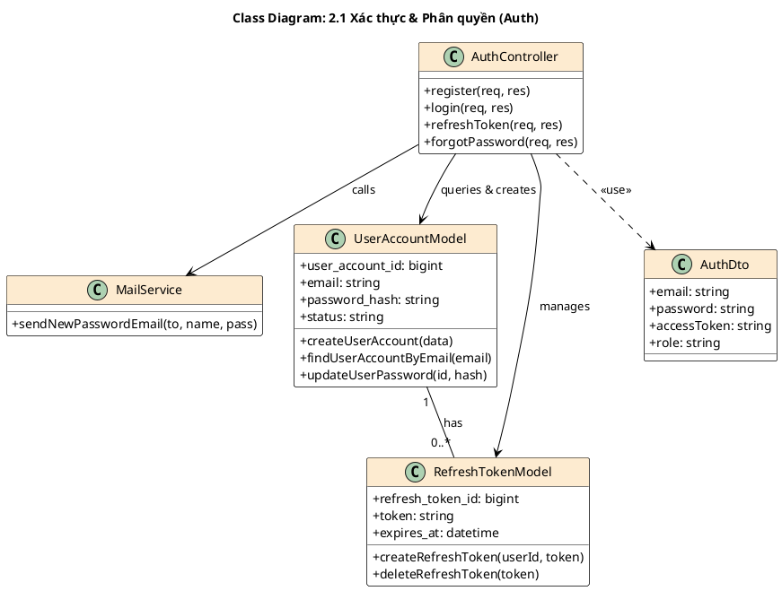

---

### 2.2: Quản lý Hồ sơ & Nhân sự (User & Staff)

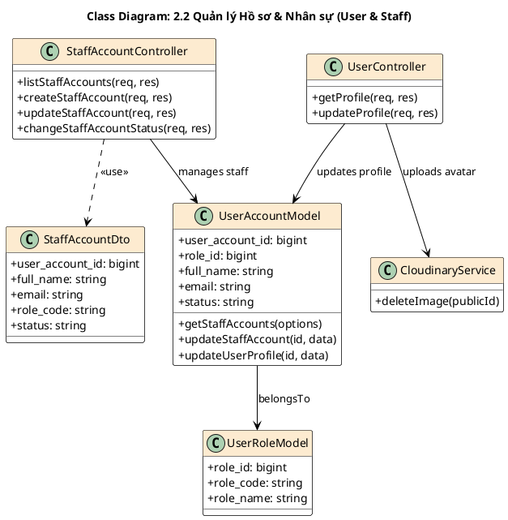

---

### 2.3: Quản lý Sản phẩm & Danh mục (Product & Catalog)

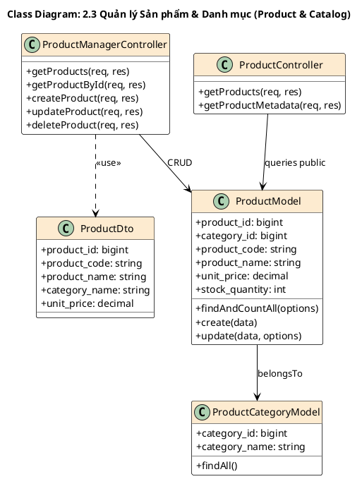

---

### 2.4: Giỏ hàng trực tuyến (Shopping Cart)

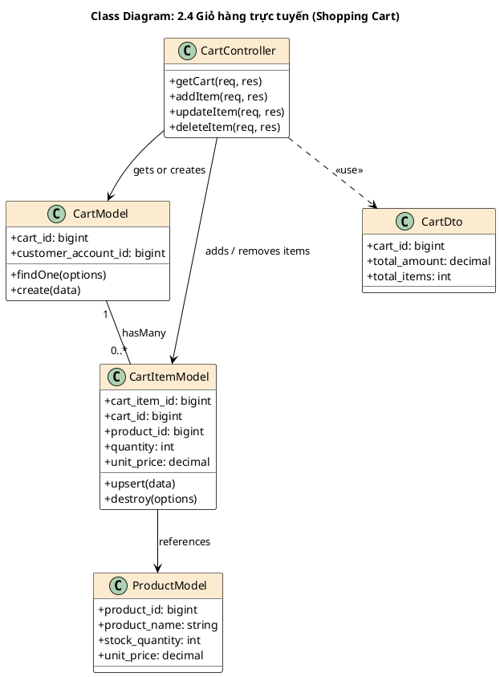

---

### 2.5: Yêu cầu Đặt hàng & Thiết kế (Order Requests)

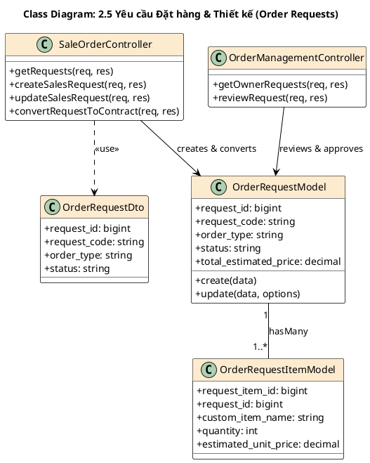

---

### 2.6: Quản lý Hợp đồng Bán hàng (Sales Contract)

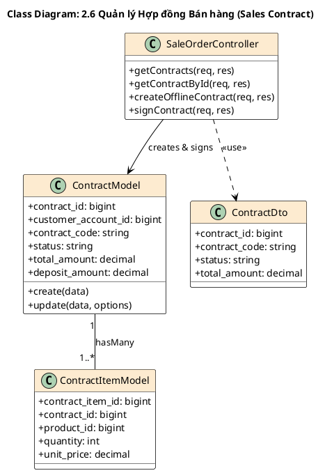

---

### 2.7: Quản lý Đơn hàng Bán (Customer Orders)

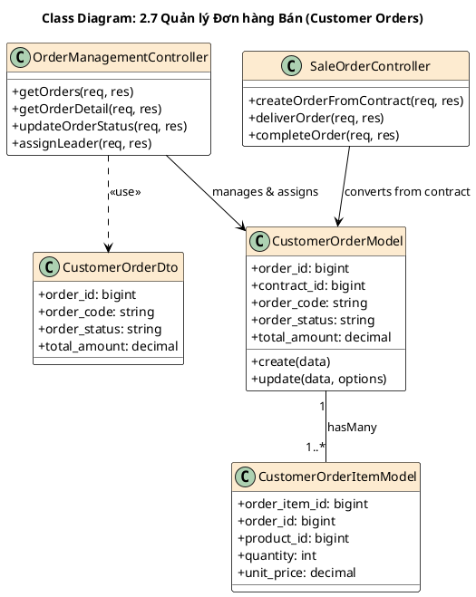

---

### 2.8: Quản lý Nhà cung cấp (Supplier)

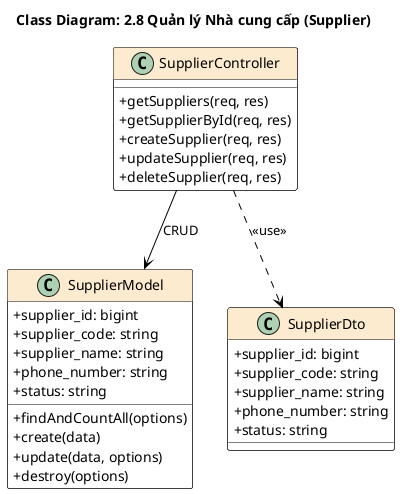

---

### 2.9: Quản lý Nguyên vật liệu & Tồn kho (Raw Material)

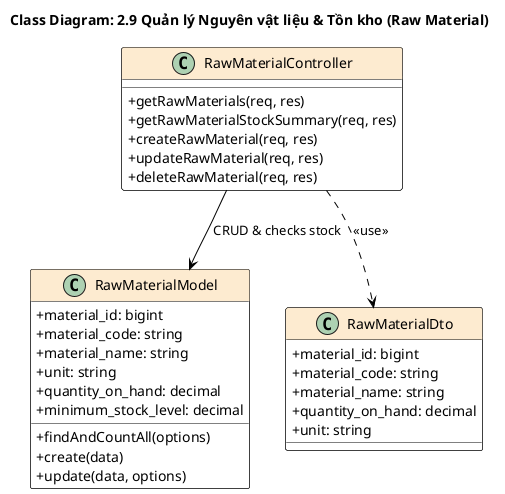

---

### 2.10: Nhập kho Nguyên vật liệu (Material Receipt)

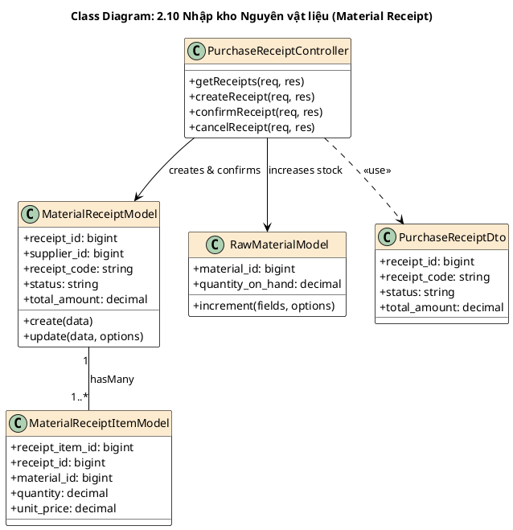

---

### 2.11: Lệnh Sản xuất & Gia công (Production Order)

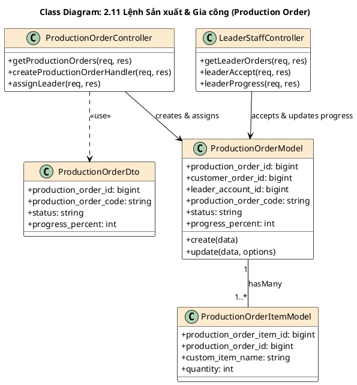

---

### 2.12: Xuất kho Nguyên vật liệu (Material Issue)

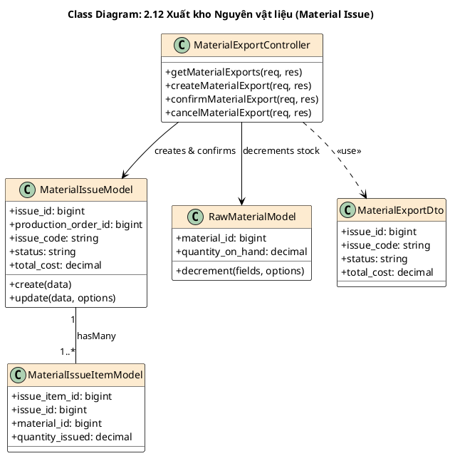

---

### 2.13: Nghiệm thu & Nhập kho Thành phẩm (Finished Goods)

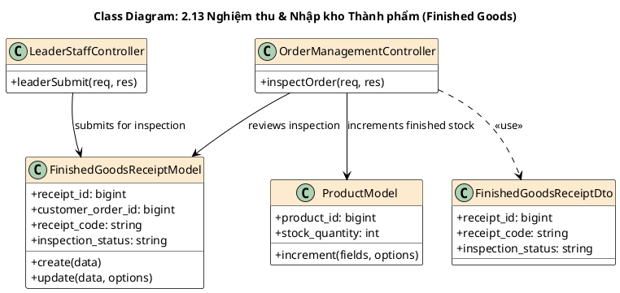

---

### 2.14: Báo cáo Tài chính & Doanh thu (Financial Reports)

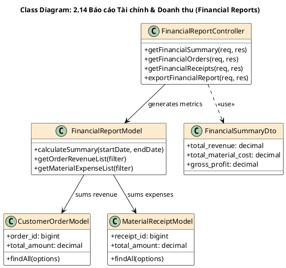
