# CLASS DIAGRAM — CẤU TRÚC THỰC TẾ FS-SIMS

> Các sơ đồ lấy tên controller, hàm export, model và service từ mã nguồn hiện tại. Backend chạy theo luồng Express route → controller → Sequelize model/model module; schema nằm trong `database/init.sql`. Không thêm DTO hay repository nếu code không có các lớp đó.

## 2.1: Xác thực & Phân quyền

> Lưu ý đối chiếu code: `authRoutes.js` đang dùng `register`, nhưng `authController.js` hiện không khai báo hàm này. Luồng đăng ký trong sequence mô tả use case dự kiến; endpoint hiện chưa chạy được cho đến khi handler có lại.

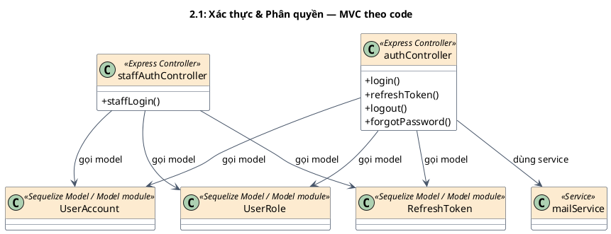

## 2.2: Hồ sơ & Nhân sự

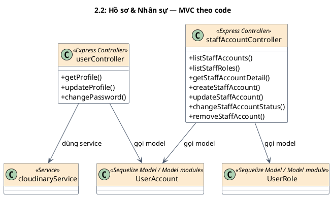

## 2.3: Sản phẩm & Danh mục

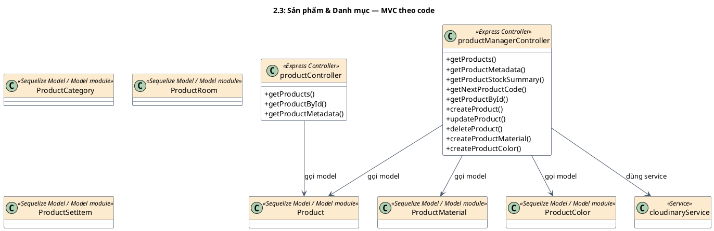

## 2.4: Giỏ hàng

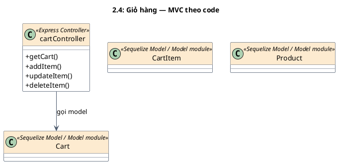

## 2.5: Yêu cầu Đặt hàng & Thiết kế

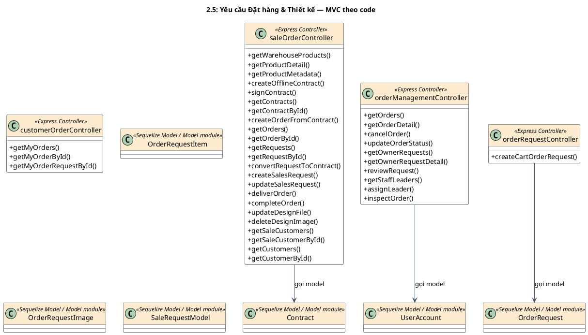

## 2.6: Hợp đồng Bán hàng

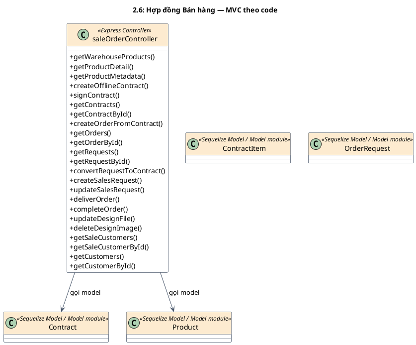

## 2.7: Đơn hàng Bán

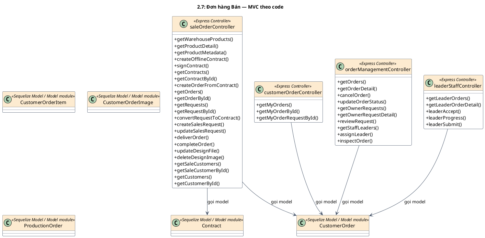

## 2.8: Nhà cung cấp

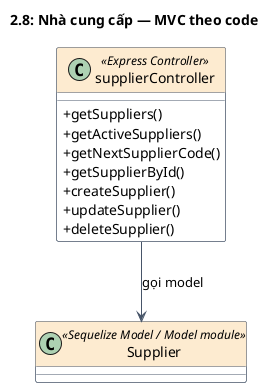

## 2.9: Nguyên vật liệu

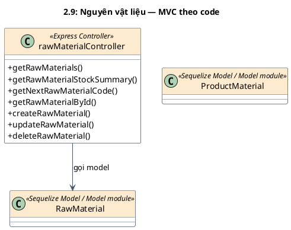

## 2.10: Nhập kho Nguyên vật liệu

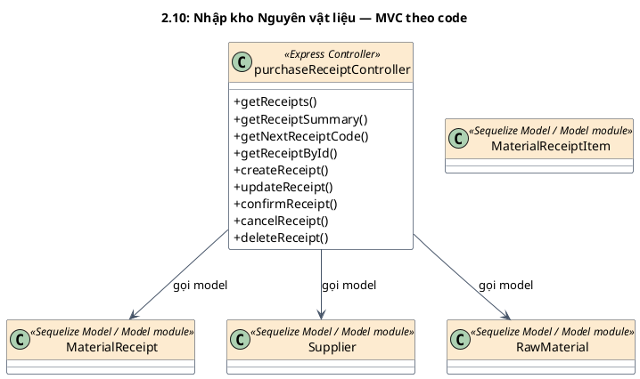

## 2.11: Lệnh Sản xuất

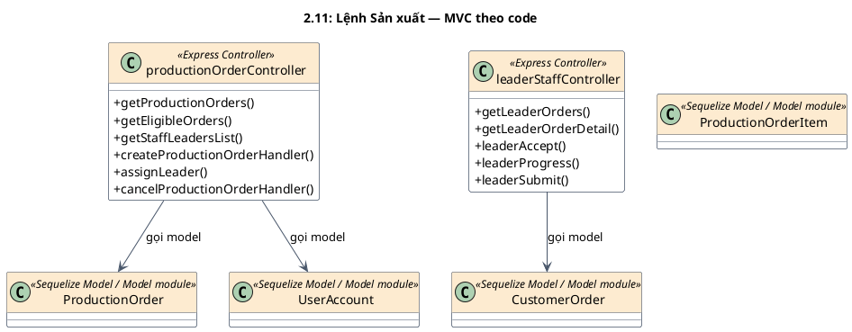

## 2.12: Xuất kho Nguyên vật liệu

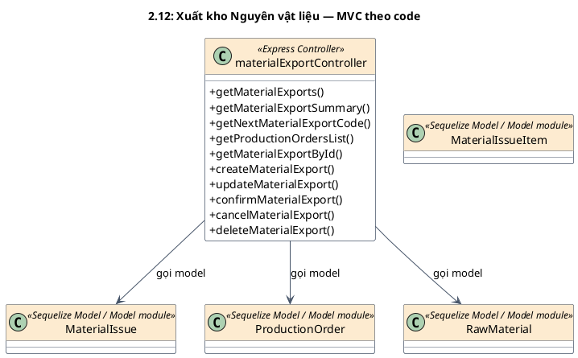

## 2.13: Nghiệm thu Thành phẩm

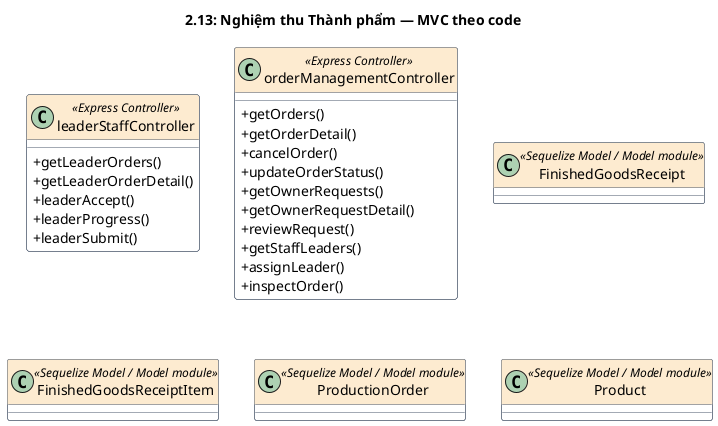

## 2.14: Báo cáo Tài chính

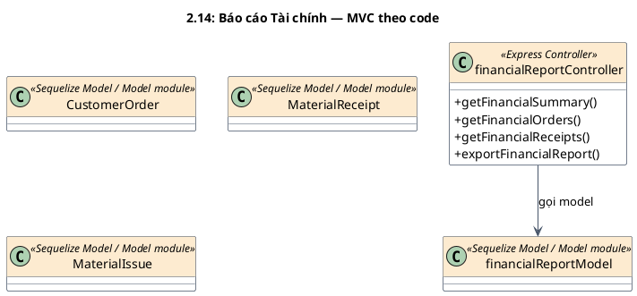
