# CLASS DIAGRAMS FS-SIMS

## 1 Authentication & Account Access

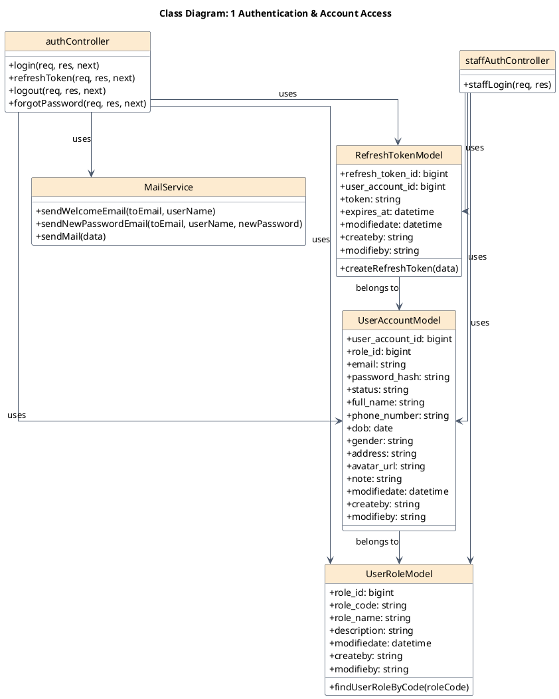

## 2 Manage Profile

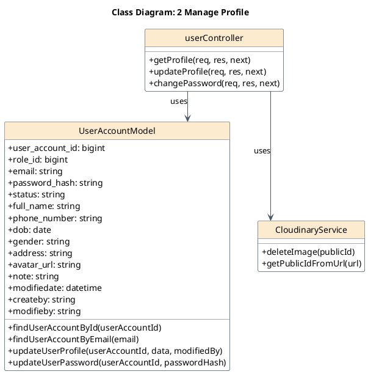

## 3 View Products

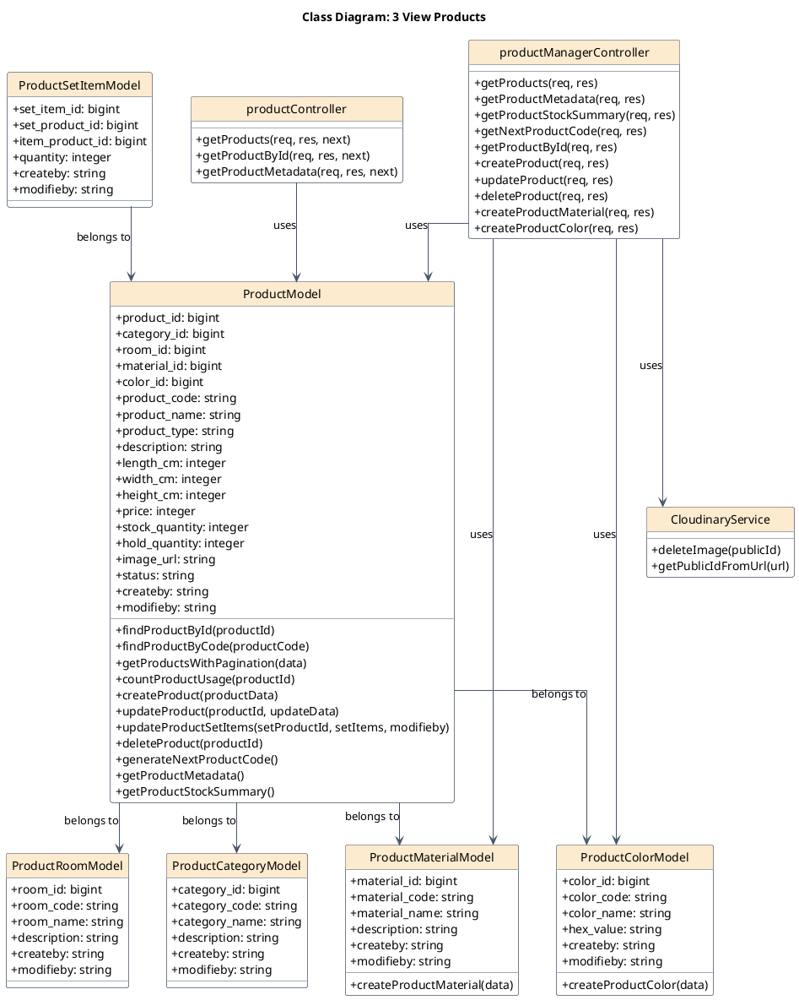

## 4 Manage Cart

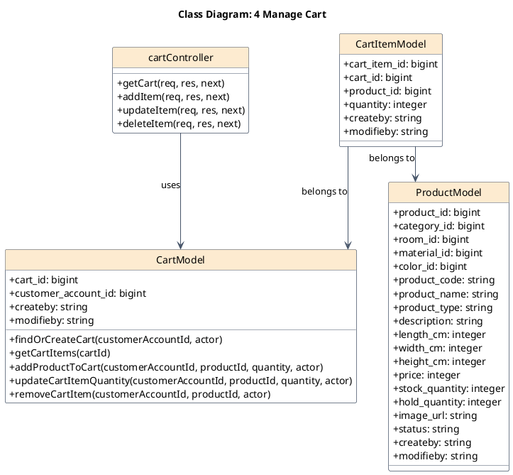

## 5 Manage Order

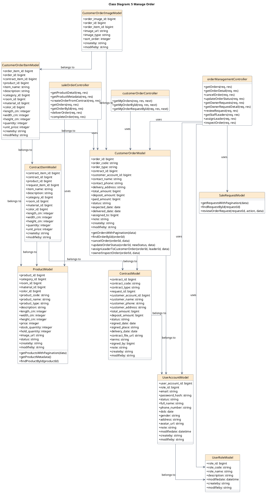

## 7 Submit Purchase Request

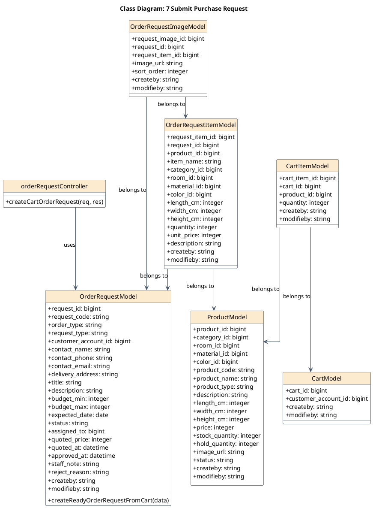

## 8 Manage Customer

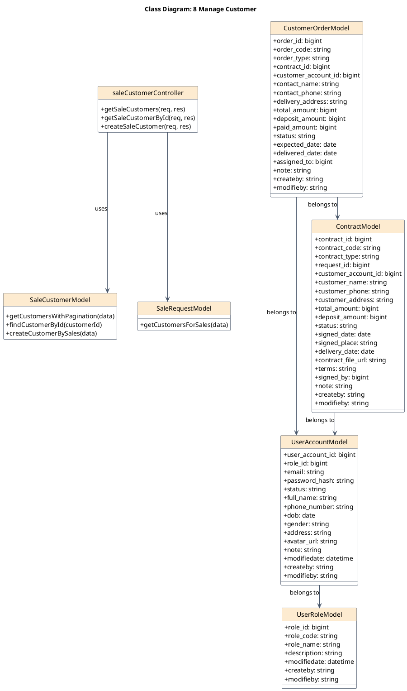

## 9 Manage Order Requirement

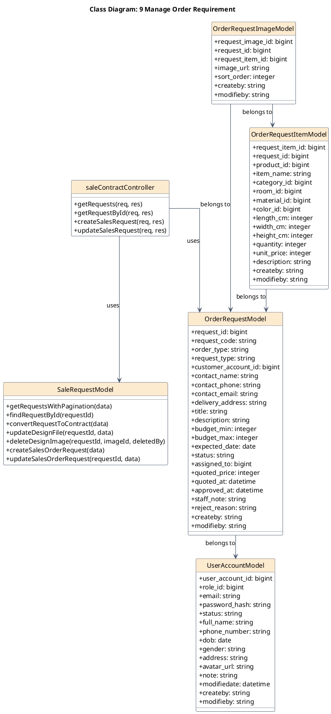

## 10 Manage Customer Requests

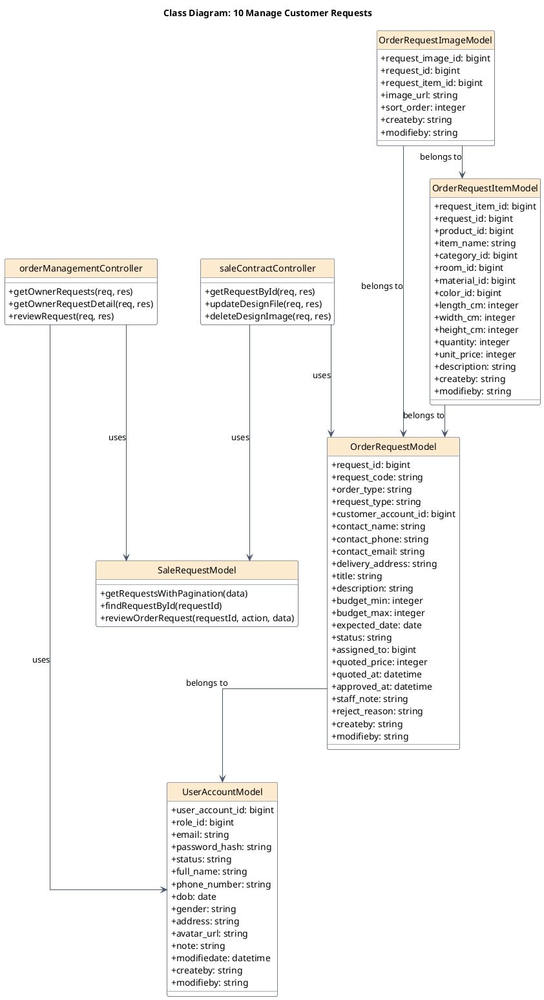

## 11 Manage Contract

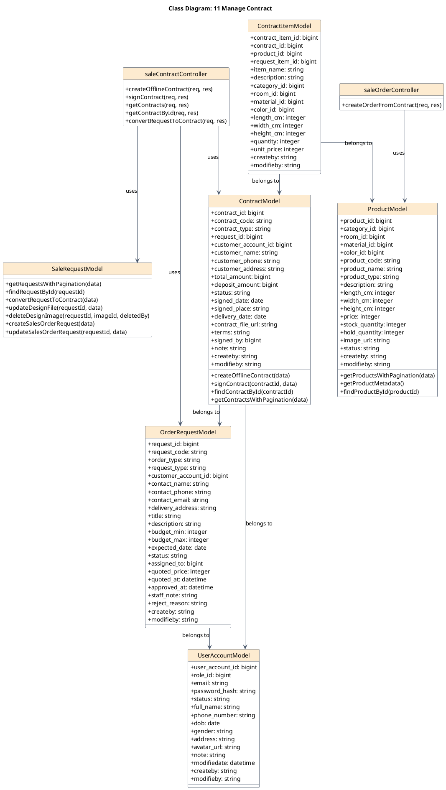

## 12 Manage Accounts

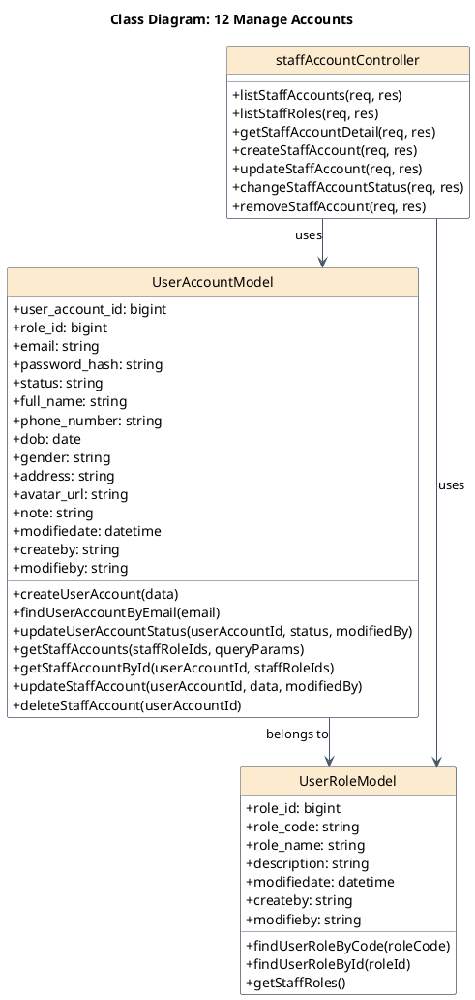

## 13 Manage Warehouse

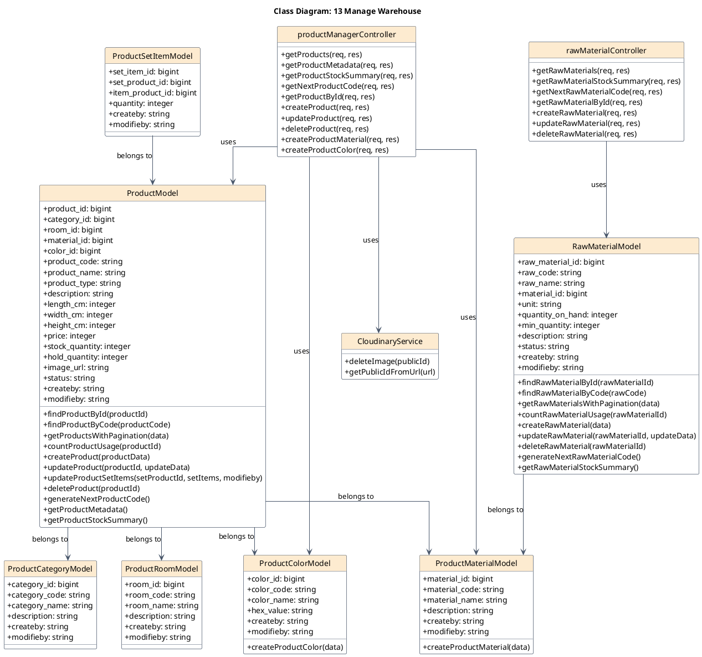

## 14 Manage Suppliers

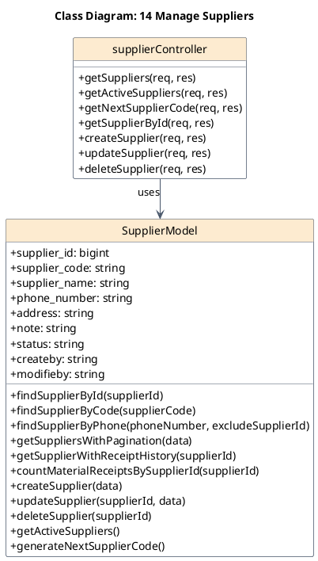

## 15 Manage Purchase Receipts

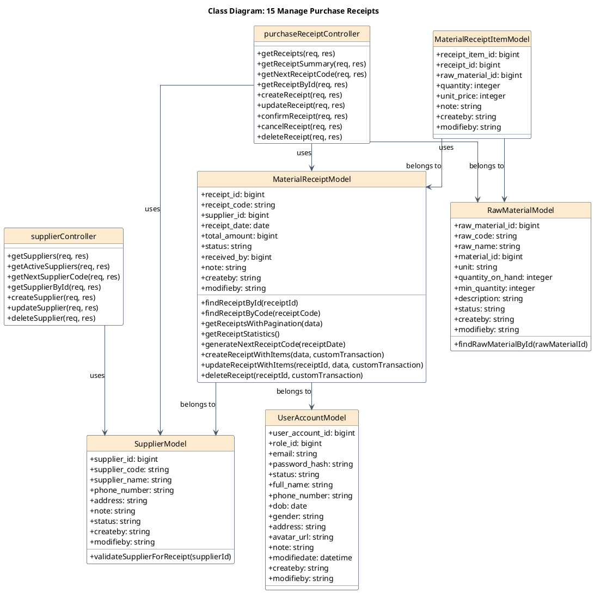

## 16 Manage Material Export

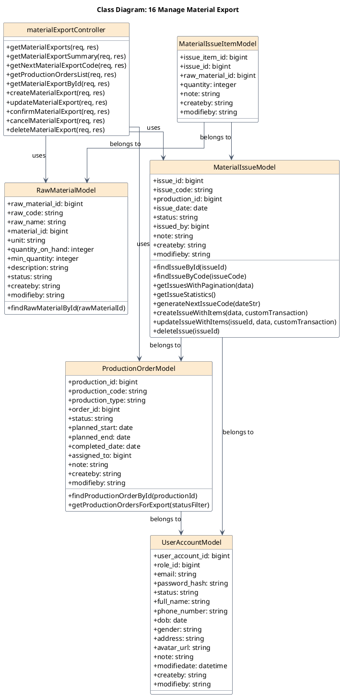

## 18 Manage Production Jobs

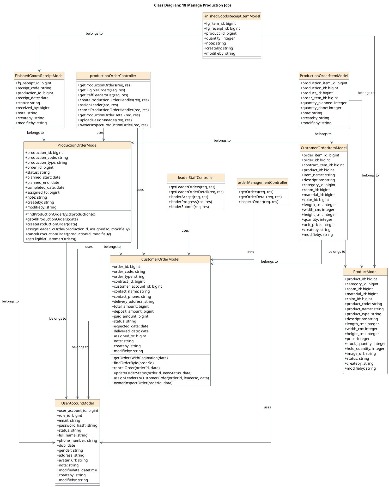

## 19 Manage Financial Reports

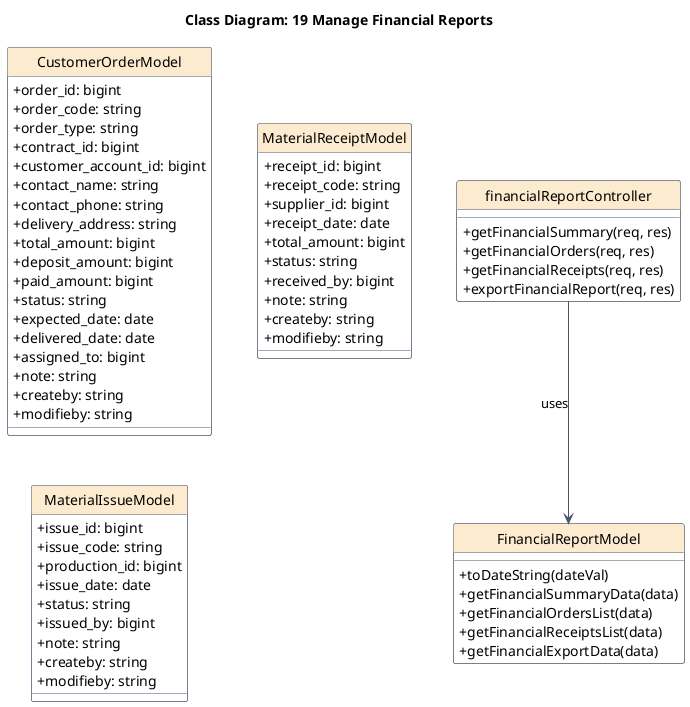
